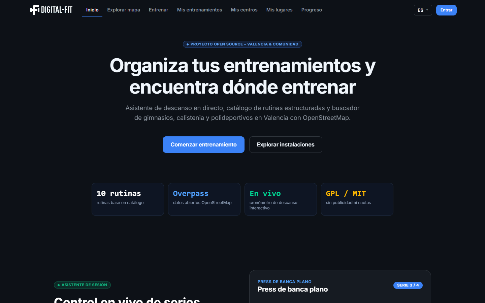
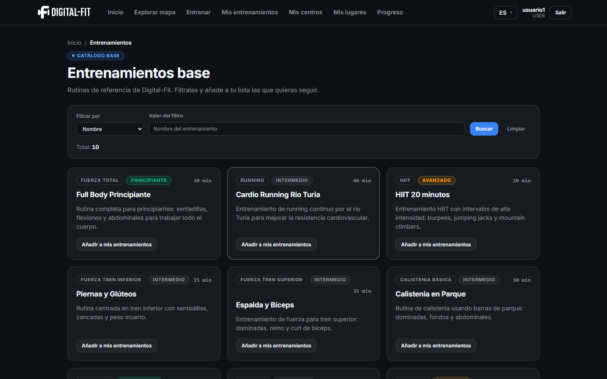
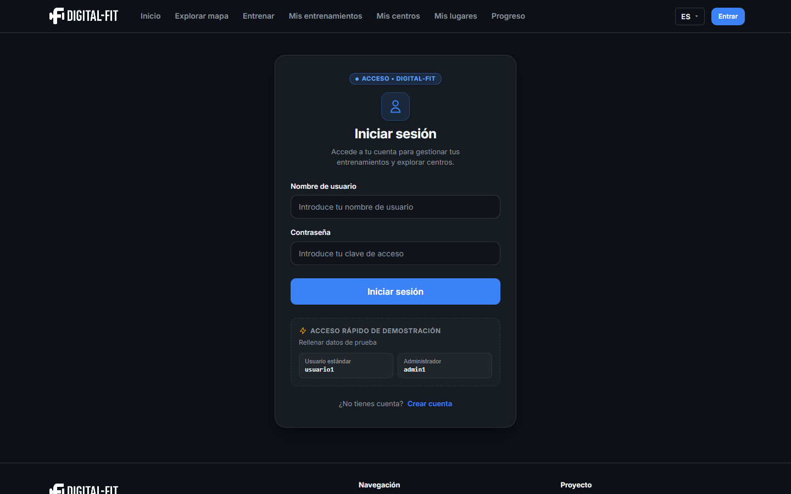

# Digital-Fit 2.0

[](https://github.com/Manuelklk03/Digital-Fit-Proyecto/actions/workflows/ci.yml)
[](https://sonarcloud.io/dashboard?id=Manuelklk03_Digital-Fit-Proyecto)
[](https://sonarcloud.io/dashboard?id=Manuelklk03_Digital-Fit-Proyecto)

Aplicación web integral para la organización y seguimiento del entrenamiento deportivo. Permite localizar centros privados y espacios públicos en mapa interactivo, gestionar y registrar rutinas de entrenamiento, publicar y consultar aportaciones de la comunidad deportiva, analizar estadísticas de progreso y emitir valoraciones.

🌐 **Despliegue público en producción:** [https://digital-fit.netlify.app](https://digital-fit.netlify.app)

---

## Capturas de la Aplicación

### Portada Principal (`/inicio`)
*Diseño orientado al rendimiento deportivo, métricas técnicas de la plataforma e internacionalización en 4 idiomas.*


### Exploración y Mapa Deportivo (`/explorar`)
*Localización de gimnasios, polideportivos, pistas y parques de calistenia con filtros por categoría y cálculo de distancias.*


### Catálogo y Gestión de Entrenamientos (`/entrenamientos`)
*Biblioteca clasificada por objetivos, niveles de dificultad, duración estimada y rutinas de la comunidad.*


### Acceso y Cuentas de Demostración (`/login`)
*Autenticación con protección CSRF, rate limiting contra ataques de fuerza bruta y acceso rápido con un clic para evaluadores.*


---

## Cuentas de Demostración para Evaluación

La aplicación desplegada dispone de dos cuentas de demostración preconfiguradas con datos persistentes en Neon PostgreSQL:

| Usuario | Contraseña | Rol | Alcance y Permisos |
|---|---|---|---|
| `usuario1` | `Usuario123!` | `USER` | Gestión completa de rutinas personales, registro en historial, favoritos en mapa y valoraciones |
| `admin1` | `Admin123!` | `ADMIN` | Todas las funciones de usuario + administración del catálogo base y alta de nuevos administradores (`/api/admin/**`) |

> En la pantalla de [Inicio de Sesión](https://digital-fit.netlify.app/login), existen botones de acceso directo que rellenan automáticamente estas credenciales.

---

## Funcionalidades Principales

- **Explorar y Mapa Deportivo:** Mapa interactivo (Leaflet + OpenStreetMap) con geolocalización, búsqueda textual y filtros dinámicos entre centros privados y espacios públicos de entrenamiento.
- **Entrenamientos Estructurados:** Catálogo base estructurado por categorías de fuerza, cardio, calistenia y movilidad; gestión de rutinas propias (`Mis entrenamientos`), espacio de comunidad deportiva e historial cronológico de sesiones realizadas.
- **Progreso y Estadísticas:** Resumen de volumen de actividad (días activos, minutos acumulados, entrenamientos completados) y valoraciones de 1 a 5 estrellas con comentarios de la comunidad.
- **Panel de Administración:** Control y mantenimiento del catálogo maestro de entrenamientos y centros deportivos, además de aprovisionamiento seguro de cuentas administradoras.
- **Seguridad en Profundidad:**
  - Sesión persistente mediante cookie `HttpOnly` (`JSESSIONID`) aislada de scripts de cliente.
  - Protección activa contra ataques CSRF (`XSRF-TOKEN` / `X-XSRF-TOKEN`) con integración en Angular HttpClient.
  - Limitador de tasa (*Rate Limiting*) en intentos de inicio de sesión: tras 5 fallos consecutivos se bloquea temporalmente el intento con `429 Too Many Requests` (RFC 7807) y cabecera `Retry-After`.
  - Cabeceras perimetrales HSTS, `X-Content-Type-Options: nosniff`, `X-Frame-Options: DENY` y aislamiento estricto de diagnósticos (`/actuator`).
- **SEO y Rendimiento:**
  - Prerenderizado estático con `@angular/ssr` (`outputMode: "static"`) de las páginas públicas (`/inicio`, `/login`, `/register`).
  - Metadatos semánticos, `robots.txt`, `sitemap.xml`, URL canónica estricta y datos estructurados JSON-LD (`WebApplication` y `BreadcrumbList`).
  - Resultados Lighthouse móvil en producción: **Rendimiento 87–89**, **Accesibilidad 95–96**, **Buenas prácticas 96**, **SEO 100**, con TBT de 20–40 ms.

---

## Stack Tecnológico

| Capa | Tecnologías |
|---|---|
| **Frontend** | Angular 22, TypeScript 6.0, Tailwind CSS v4, PostCSS, Leaflet, Vitest |
| **Backend** | Java 25, Spring Boot 4, Spring Security, Spring Data JPA, Hibernate, Flyway |
| **Base de Datos** | PostgreSQL 17 (Neon Serverless en producción) |
| **DevOps y Cloud** | Docker, Docker Compose, GitHub Actions (CI/CD), Netlify (CDN y proxy inverso), Render (Web Service) |
| **Calidad y Tests** | SonarQube Cloud (Quality Gate *Sonar way*), Playwright (E2E), Prettier, ESLint |

Detalle de decisiones y patrones en [docs/architecture.md](docs/architecture.md).

---

## Ejecución en Local con Docker

Requisitos: **Docker Desktop** iniciado y **Git**.

1. Clonar el repositorio:
   ```bash
   git clone https://github.com/Manuelklk03/Digital-Fit-Proyecto.git
   cd Digital-Fit-Proyecto
   ```

2. Arrancar todos los servicios (PostgreSQL 17, Backend Spring Boot y Frontend Angular con nginx):
   ```bash
   docker compose up --build
   ```

3. Acceder a los servicios:
   - **Frontend (SPA):** [http://localhost:4200](http://localhost:4200)
   - **Backend API:** [http://localhost:8080](http://localhost:8080)
   - **Salud del Backend:** [http://localhost:8080/actuator/health](http://localhost:8080/actuator/health)
   - **PostgreSQL:** `localhost:5433` (Base: `digital_fit`, Usuario: `digitalfit`, Clave: `digitalfit`)

Para detener los contenedores conservando los datos:
```bash
docker compose down
```

Para detener y reiniciar la base de datos limpia:
```bash
docker compose down -v
```

---

## Arquitectura de Despliegue en la Nube

El despliegue de producción se organiza en tres proveedores bajo planes gratuitos permanentes:

```text
Navegador (Usuario)
       │
       ▼ (HTTPS)
Netlify CDN (https://digital-fit.netlify.app)
  ├── Páginas públicas prerenderizadas (/inicio, /login, /register)
  ├── Fallback SPA para rutas privadas (index.csr.html con noindex)
  └── Proxy inverso perimetral: /api/*  ──►  Render Web Service
                                                    │
                                                    ▼ (JDBC SSL)
                                           Neon Serverless PostgreSQL 17
```

- **Netlify:** Alojamiento estático global y proxy inverso que evita peticiones entre dominios cruzados, permitiendo cookies de primera parte con atributos `Secure` y `SameSite=Lax`.
- **Render:** Ejecución del contenedor backend compilado y firmado en Docker Hub (`manuelklk03/digital-fit-backend`).
- **Neon:** Base de datos PostgreSQL 17 gestionada con migraciones versionadas mediante Flyway.

Guía completa de configuración de entornos en [docs/deployment.md](docs/deployment.md).

---

## Origen y Evolución del Proyecto

Digital-Fit se originó como proyecto final del ciclo formativo de grado superior en Desarrollo de Aplicaciones Web (DAW). Dicha versión académica inicial se encuentra preservada en el tag inmutable [`v1.0.0`](https://github.com/Manuelklk03/Digital-Fit-Proyecto/tree/v1.0.0).

La versión **2.0** representa una refactorización integral hacia estándares profesionales de la industria: migración a PostgreSQL y Flyway, pipeline completo de integración continua con SonarQube Cloud y pruebas E2E en Playwright, sistema de diseño desacoplado con Tailwind CSS y tokens semánticos, estandarización de errores HTTP en RFC 7807 (`ProblemDetail`), seguridad CSRF / rate limiting y prerenderizado estático con `@angular/ssr`. Historial completo de cambios en [CHANGELOG.md](CHANGELOG.md).

---

## Autor

**Manuel Casinos Pérez** · [GitHub](https://github.com/Manuelklk03) · [LinkedIn](https://www.linkedin.com/in/manuel-casinos-perez/)
